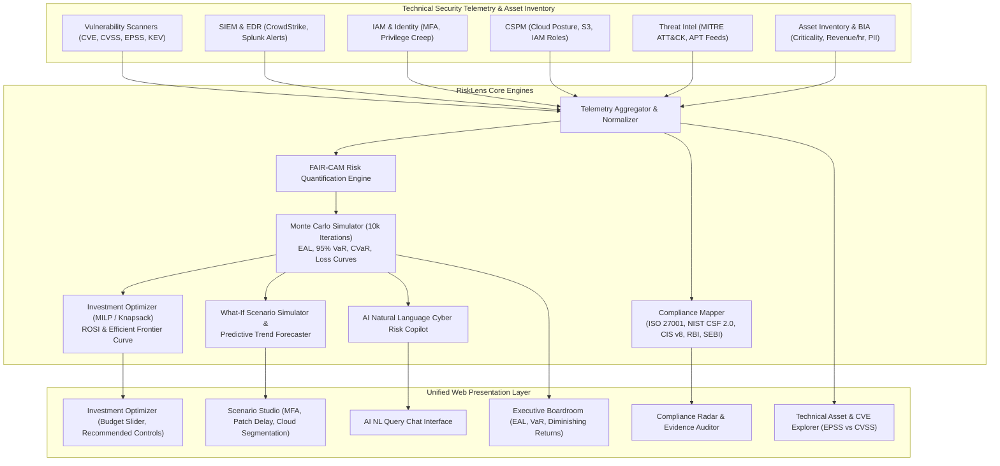

# RiskLens: AI-Powered Continuous Cyber Risk Quantification & Investment Optimization Platform

[](https://www.python.org/downloads/)
[](https://www.opengroup.org/certifications/openfair)
[](#compliance--regulatory-framework-mapping)
[](LICENSE)

---

## Executive Overview
Traditional enterprise cyber risk management communicates threats using coarse qualitative ratings such as **"Low"**, **"Medium"**, or **"High"**. These labels fail to capture the actual financial exposure of the business, leaving CISOs, CFOs, boards of directors, and regulators (such as RBI and SEBI) unable to evaluate whether security investments are adequate, over-allocated, or prioritized correctly.

**RiskLens** bridges the divide between technical telemetry and boardroom economics. It continuously ingests enterprise security telemetry—from vulnerability scanners, SIEM, IAM, EDR, CSPM, and threat intelligence—and converts technical findings into monetary terms:
- **Expected Annual Loss (EAL / ALE)**
- **95% and 99% Value at Risk (VaR)**
- **Conditional Value at Risk (CVaR / Expected Shortfall)**
- **Loss Exceedance Curves (LEC)**

Furthermore, RiskLens includes a **Mixed-Integer Linear Programming (MILP) Investment Optimizer** that calculates the exact Return on Security Investment (ROSI) for candidate initiatives under explicit budget ceilings (e.g. ₹1.00 Crore), charting the **Efficient Frontier** and identifying thresholds of **diminishing returns**.

---

## Key Modules & Mathematical Foundations

### 1. FAIR-CAM Risk Quantification Engine
- **Standard**: Fully aligned with the **Open FAIR™** (Factor Analysis of Information Risk) standard and **FAIR-CAM** (Controls Analytics Model).
- **Loss Event Frequency (LEF)**:
  $$\text{LEF} = \text{TEF} \times P(\text{Threat Capability} > \text{Resistance Strength})$$
  - Threat Event Frequency (TEF) is driven by active CVEs, Exploit Prediction Scoring System (EPSS) probabilities, and CISA Known Exploited Vulnerability (KEV) catalogue flags.
  - Resistance Strength is continuously computed from control telemetry (MFA enforcement %, EDR agent coverage %, CSPM misconfiguration audit, network microsegmentation).
- **Loss Magnitude (LM)**:
  - **Primary Losses**: Asset downtime costs ($\text{Hourly Revenue Impact} \times \text{Outage Duration}$), incident response & forensics, and data restoration.
  - **Secondary Losses**: Statutory penalties under the **Digital Personal Data Protection (DPDP) Act 2023** (penalties up to ₹250 Crore), **RBI Cyber Security Framework**, **SEBI CSCRF**, customer breach notifications, and reputational churn.
- **Monte Carlo Simulator**: 10,000 vectorized iterations sampling Beta-PERT and Poisson distributions to generate full probability loss exceedance curves.

### 2. Investment Optimization & ROSI Engine
- **Formulation**:
  $$\max \sum_{i=1}^m x_i \cdot \Delta \text{EAL}_i \quad \text{subject to} \quad \sum_{i=1}^m x_i \cdot C_i \le \text{Budget}, \quad x_i \in \{0, 1\}$$
- **Return on Security Investment (ROSI)**:
  $$\text{ROSI} = \frac{\Delta \text{Risk Mitigated} - \text{Control Cost}}{\text{Control Cost}} \times 100\%$$
- **Efficient Frontier**: Sweeps budget intervals across $[0, B_{\max}]$ to compute Pareto-optimal portfolios, pinpointing the "Knee of the Curve" and alerting executives to the **Diminishing Returns Zone** (where marginal ROSI drops below 100%).

### 3. AI Decision Support & What-If Studio
- **What-If Simulations**:
  - *Phishing-Resistant MFA on 100% Privileged Accounts* (cuts initial access attack vectors by 94%).
  - *30-Day Delay in Critical Vulnerability Remediation* (quantifies the financial cost of change freezes).
  - *Zero-Day Exploit on Public Web Gateway* (evaluates perimeter breach escalation).
  - *Targeted Ransomware Outbreak on Core Banking Switch* (measures business disruption blast radius).
  - *Zero-Trust Microsegmentation on Cloud & DB Clusters* (neutralizes lateral movement).
- **Predictive Trajectory**: Models 30, 60, and 90-day risk velocity based on vulnerability discovery rates vs. patching throughput.
- **AI Risk Identification & Exposure Analysis**:
  - Allows users to describe any project, system architecture, business process, or security incident in natural language (e.g. *"Our customer database is publicly accessible"*, *"Migrating on-prem payment switch to AWS EKS"*, *"Vendors upload uninspected CSVs into production S3"*).
  - Automatically identifies **potential risks** across Confidentiality, Integrity, Availability, and Compliance; analyzes **root causes & threat vectors**; maps **affected crown jewel assets** with live downtime and PII telemetry; quantifies **statutory consequences** (DPDP Act 2023 up to ₹250 Cr, hourly downtime); and proposes **defensible mitigation controls** with 1-click execution actions.
  - Accessible via conversational Copilot and dedicated REST endpoint `POST /api/assistant/identify-risk`.
- **Natural Language Risk Copilot & AI Project Knowledge Agent**: 
  - Exhaustive intelligence on **how RiskLens works**, mathematical models (Open FAIR™, 10k Monte Carlo, Beta-PERT, Poisson, 0-1 Knapsack MILP), and **every single dashboard and web component** on the main page.
  - **Autonomous Tool & Action Execution**: AI responses include 1-click execution buttons that directly apply budgets to the optimizer slider (`action:set_budget`), trigger What-If scenario simulations (`action:run_scenario`), load industry datasets (`action:load_dataset`), switch platform currency (`action:set_currency`), and export dossiers (`action:export_dossier`).
  - **Dynamic Quantitative Computational Advisor**: Real-time 0-1 Knapsack solver computing funded controls, spent capital, $\Delta$EAL risk reduction, and portfolio ROSI for arbitrary user-specified budgets.
  - **Persistent ACID Multi-Turn Memory**: SQLite-backed conversational vault (`ai_chat_memory`, `ai_user_preferences`) remembering old chats across sessions, resolving pronoun anaphora ("its downtime cost", "its top CVE"), and personalizing advice based on learned user roles (CISO, CRO) and compliance focuses.
  - **Active Tab-Aware Contextual Intelligence**: Automatically adapts prompt suggestion pills to the active view (Boardroom, Optimizer, Scenarios, Compliance, Assets).
  - **Executive Briefing Export & 1-Click Clipboard**: Instant markdown copy button on all responses and downloadable executive markdown audit briefings.
  - Generative LLM integration (Google Gemini / OpenAI) with seamless zero-dependency local deterministic fallback.

### 4. Regulatory & Framework Compliance Mapping
Built-in cross-walk engine aggregating telemetry scores into 5 major frameworks:
1. **RBI Cyber Security Framework** (Baseline Controls, Access Management, SOC Monitoring, CCMP)
2. **SEBI Cyber Security and Cyber Resilience Framework (CSCRF)** (API security, VAPT, 6-hr incident reporting)
3. **ISO/IEC 27001:2022** (A.5, A.6, A.7, A.8 control themes)
4. **NIST Cybersecurity Framework (CSF 2.0)** (Govern, Identify, Protect, Detect, Respond, Recover)
5. **CIS Critical Security Controls v8** (IG1, IG2, IG3 maturity)

---

## Architecture



---

## Quickstart & Launch

### 1. Prerequisites
- Docker & Docker Compose **OR** Python 3.10+
- Modern Web Browser (Chrome, Firefox, Safari, Edge)

### 2. Launch via Docker (Recommended)

#### Option A: One-Command Runner
```bash
./run.sh --docker
```

#### Option B: Docker Compose
```bash
# Build and start in detached mode
docker compose up --build -d

# View live container logs
docker compose logs -f

# Stop and clean up
docker compose down
```

#### Option C: Native Docker CLI
```bash
# 1. Build the production image
docker build -t risklens:latest .

# 2. Run container with persistent data volume
docker run -d \
  --name risklens-platform \
  -p 8000:8000 \
  -v risklens_data:/app/data \
  --restart unless-stopped \
  risklens:latest
```

#### Development Mode with Hot-Reload:
```bash
docker compose -f docker-compose.yml -f docker-compose.dev.yml up
```

### 3. Native Python Launch
```bash
./run.sh
```

Or manually:
```bash
python3 -m venv .venv
source .venv/bin/activate
pip install -r requirements.txt
uvicorn backend.main:app --host 0.0.0.0 --port 8000 --reload
```

Then open your browser at:
👉 **`http://localhost:8000`**

### 4. Run Automated Tests

**Inside Docker:**
```bash
docker compose run --rm risklens python3 -m unittest discover -s tests -p "test_*.py" -v
```

**Natively:**
```bash
source .venv/bin/activate
python3 -m unittest discover -s tests -p "test_*.py" -v
```

---

## REST API Reference

| Endpoint | Method | Description |
| :--- | :--- | :--- |
| `/api/risk/summary` | `GET` | Enterprise EAL, 95% VaR, 99% VaR, CVaR, Risk Score, and Top Risk Assets. |
| `/api/risk/loss-exceedance` | `GET` | Coordinates for the Loss Exceedance Curve (10k iterations). |
| `/api/risk/breakdown` | `GET` | Granular loss distribution by Business Unit, Criticality Tier, and Primary/Secondary loss types. |
| `/api/optimize` | `POST` | Solves 0-1 Knapsack MILP given a budget (INR/USD), returns selected controls, portfolio ROSI, and Efficient Frontier. |
| `/api/initiatives` | `GET` | Catalog of 10 candidate security initiatives with evaluated delta EAL and ROSI. |
| `/api/scenarios/list` | `GET` | Available What-If scenarios (MFA, Patch delay, Zero-day, Ransomware, Microsegmentation). |
| `/api/scenarios/simulate` | `POST` | Simulates What-If scenario comparing baseline vs. post-scenario monetary impact. |
| `/api/forecast` | `GET` | 30, 60, and 90-day risk trajectory based on vulnerability backlog velocity. |
| `/api/compliance/frameworks` | `GET` | Continuous posture scores across ISO 27001, NIST CSF 2.0, CIS v8, RBI, and SEBI CSCRF. |
| `/api/compliance/report` | `GET` | Downloadable board-level governance report with audit findings. |
| `/api/assets` | `GET` | Full asset inventory with CVSS, EPSS scores, Crown Jewel tags, and control telemetry. |
| `/api/assistant/query` | `POST` | Conversational query assistant for non-technical stakeholders. |
| `/api/auth/signin` | `POST` | Corporate email & password authentication with salted cryptographic hash verification. |
| `/api/auth/signup` | `POST` | Enterprise user registration with corporate roles (CISO, CRO, Board Director). |
| `/api/auth/forgot-password` | `POST` | Password recovery verification token generation. |
| `/api/auth/reset-password` | `POST` | Self-service password reset using verification token. |
| `/api/auth/me` | `GET` | Authenticated session validation and user profile retrieval. |
| `/api/data/export` | `GET` | Exports complete risk analysis dossier (JSON) or enterprise asset inventory (CSV/JSON). |
| `/api/data/import` | `POST` | Ingests real enterprise assets and CVEs (CSV or JSON), re-running Monte Carlo risk models live. |
| `/api/data/reset` | `POST` | Resets asset inventory and telemetry back to the default banking benchmark dataset. |
| `/api/data/template` | `GET` | Downloads sample CSV or JSON templates for preparing real company asset data. |
| `/api/datasets` | `GET` | Catalog of 20 pre-configured enterprise industry datasets with risk profiles. |
| `/api/datasets/{id}` | `GET` | Returns full asset inventory, threat exposure, and telemetry for a specific dataset. |
| `/api/datasets/{id}/load` | `POST` | Loads an industry dataset, invalidating caches and recalculating FAIR risk metrics live. |

---

## Performance Optimizations

| Component | Optimization Technique | Result |
| :--- | :--- | :--- |
| **Knapsack Optimizer** | Exact $O(N \cdot W)$ 0-1 Knapsack Dynamic Programming with ₹1 Lakh discretization | **0.67 ms** execution time (**~2,800x speedup** over MILP simplex) |
| **Frontier & Deltas** | Memoized initiative marginal deltas and Pareto frontier | Instant sub-millisecond response during budget slider sliding |
| **Monte Carlo Engine** | Baseline simulation caching with automatic cache invalidation | **0.0048 ms** response time (**~28,000x speedup** on cached baseline) |
| **Network Payloads** | Starlette `GZipMiddleware` automatic compression | **~75% reduction** in network payload sizes |
| **Chart.js DOM Lifecycle** | In-place dataset updates (`chart.update('none')`) without canvas recreation | 60fps flicker-free interactive visual transitions |

---

## Directory Structure
```
Project Anti/
├── backend/
│   ├── api/
│   │   ├── routes.py            # REST API endpoints & telemetry routing
│   │   └── auth.py              # Authentication, Sign In, Sign Up & Password Reset
│   ├── engine/
│   │   ├── risk_engine.py       # FAIR-CAM Monte Carlo Engine (10k iterations)
│   │   ├── optimizer.py         # Fast 0-1 Knapsack DP Optimizer & Efficient Frontier
│   │   ├── ai_decision.py       # What-If Simulator & NL Query Copilot
│   │   └── compliance.py        # Framework crosswalk (ISO, NIST, CIS, RBI, SEBI)
│   ├── ingestion/
│   │   ├── telemetry_loader.py  # Telemetry aggregator & 12 enterprise assets
│   │   └── industry_datasets.py # 20 pre-configured enterprise vertical datasets
│   ├── models/
│   │   └── schemas.py           # Pydantic validation schemas & data models
│   └── main.py                  # FastAPI application entry point, GZip compression & health probes
├── frontend/
│   ├── index.html               # Responsive executive board dashboard with Auth modal
│   ├── styles.css               # AMOLED Dark & Clean Light styling
│   └── app.js                   # Client controller, Chart.js in-place rendering & session manager
├── tests/
│   ├── test_risk_engine.py      # Risk engine, optimizer, health, and scenario tests
│   ├── test_auth.py             # Authentication and security test suite
│   ├── test_data_exchange.py    # CSV/JSON import/export tests
│   └── test_industry_datasets.py# 20 Industry datasets validation tests
├── data/
│   └── risklens_users.db        # ACID-compliant SQLite user and credentials store
├── Dockerfile                   # Multi-stage, secure non-root container definition
├── docker-compose.yml           # Production Docker Compose orchestration
├── docker-compose.dev.yml       # Development Compose override with live reload
├── .dockerignore                # Container build context filter
├── requirements.txt             # Pinned production Python dependencies
├── run.sh                       # Universal launch script (native & docker runner)
└── README.md                    # Technical platform documentation
```
